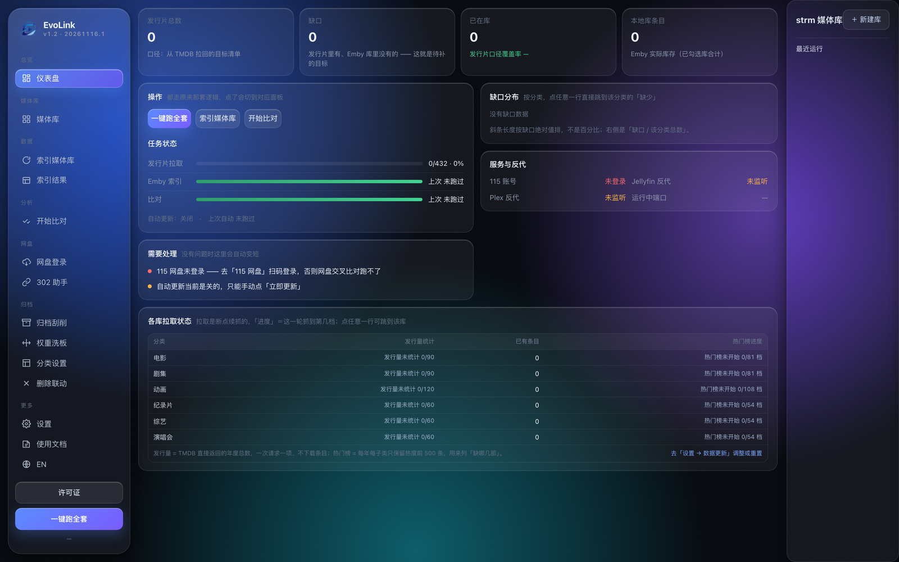
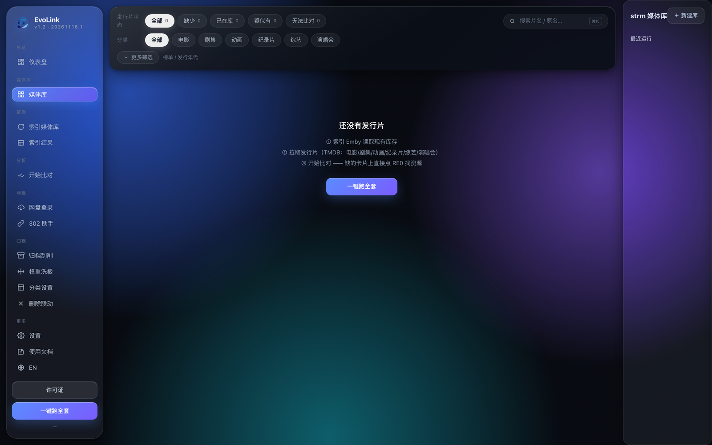
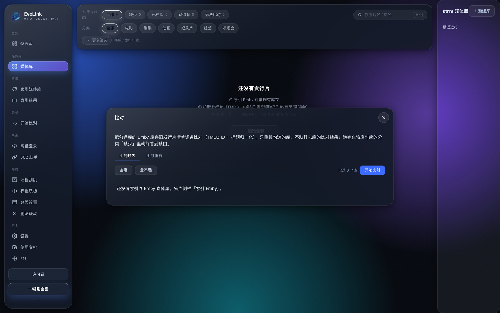
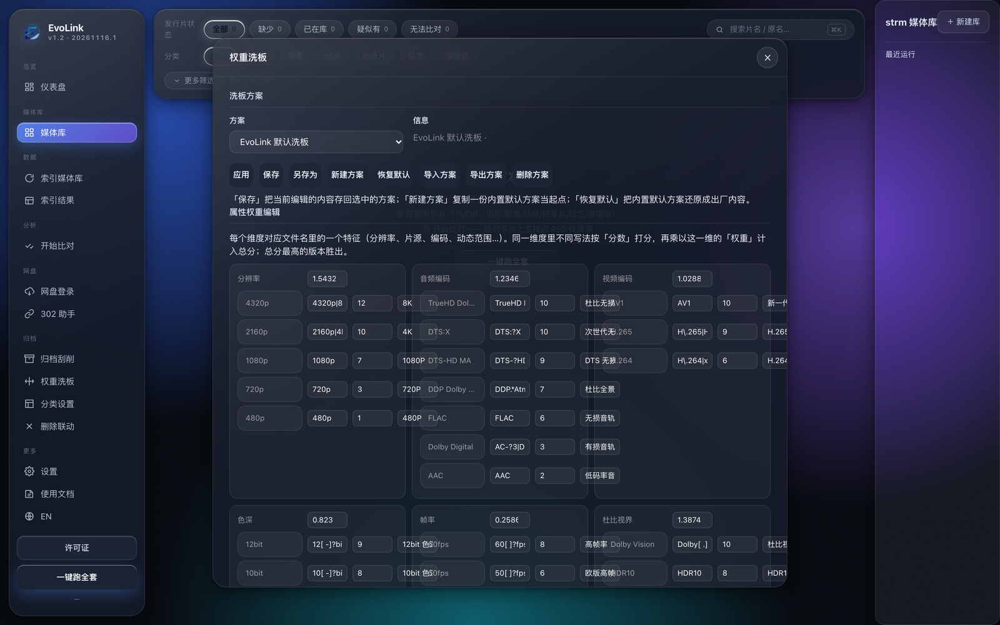

<div align="center">

# EvoLink-CN

## 面向 Emby / Jellyfin / Plex / Playable 的影视库缺口比对与 strm 运维工具
### 国内版 · 精简元数据来源

[简体中文](README.md) · [English summary](#english-summary) · [国际版仓库](https://github.com/lichangzhou/Evolink)

[](LICENSE)
[](https://www.python.org/)
[](compose.yml)
[](https://github.com/lichangzhou/EvoLink-CN)
[](https://github.com/lichangzhou/EvoLink-CN)
[](https://github.com/lichangzhou/EvoLink-CN/issues)
[](https://github.com/lichangzhou/EvoLink-CN/commits/main)

</div>

---

EvoLink 把网盘里的资源变成一份干净、去重、可直接播放的 `.strm` 媒体库，
并且**告诉你这个库里到底缺了什么**。

大多数「媒体管理器」只做一件事：扫目录、改文件名。EvoLink 站在更高一层 ——
它知道你常用的媒体服务器里已经有什么、发行目录里有什么，两者的**差额**就是你要补的。

- **纯 Python 标准库**，零第三方依赖
- **单容器**部署，代码、页面、依赖全在镜像里
- **四源索引** —— Emby / Plex / Jellyfin / Playable 并排索引，同一作品只算一次
- **两个版本** —— 本仓库是国内版；
  [国际版](https://github.com/lichangzhou/Evolink) 引擎完全一致，额外提供更多元数据来源

---

## 目录

- [功能一览](#功能一览)
- [界面](#界面)
- [快速开始](#快速开始)
- [配置](#配置)
- [架构](#架构)
- [生态：三个项目一起用](#生态三个项目一起用)
- [常见问题](#常见问题)
- [版本分层](#版本分层)
- [参与贡献](#参与贡献)
- [English summary](#english-summary)

---

## 功能一览

| 模块 | 做什么 |
|---|---|
| **四源索引** | Emby / Plex / Jellyfin / Playable 统一索引到本地库，跨库按库名合并，支持搜索、筛选、分页 |
| **缺口比对** | 拿你的库存去和 TMDB、豆瓣、榜单等发行目录比对，逐库列出「缺什么」，可导出清单 |
| **115 → 302 换链** | `.strm` 里只写网盘路径，播放时才签直链并 302 跳转，Emby / Jellyfin / Plex 三套反代各自独立 |
| **归档刮削** | 按 TMDB 信息生成规范命名的 `.strm`，目录层级由你自己的分类规则决定；先出计划预览，确认后才落盘 |
| **权重洗板** | 同一作品多个版本（4K REMUX / 1080p WEB-DL…）按 13 个维度打分，只留最优版本；方案可导出/导入 JSON |
| **分类设置** | 定义「媒体类型 → 二级分类 → 三级子目录」的层级规则，带模板、字段字典、条件说明 |
| **删除联动** | Emby 里删除条目时自动清理对应 `.strm`（webhook） |
| **网盘登录** | 115 扫码登录、目录树、链接校验；支持「本地模式」扫描，零网盘请求 |
| **反向代理** | 托管 Emby / Jellyfin / Plex 的 `302` 反代，含 `plex.direct` 自签证书 |

---

## 界面

**仪表盘** —— 四源库存、缺口计数、任务队列一眼看完。



**媒体库** —— 四个库的条目合并浏览，按类型与分类筛选。



**开始比对** —— 勾选要对比的库，与发行目录逐条比对。



**权重洗板** —— 13 个维度的打分表，每维可配黑名单/白名单。



更多截图见 [`docs/assets/`](docs/assets/)。

---

## 快速开始

### 1. 克隆并准备

```bash
git clone https://github.com/lichangzhou/EvoLink-CN.git
cd EvoLink-CN
mkdir -p data
```

### 2. 改两个必填挂载

`compose.yml` 的默认值可以直接用，但请把路径改成你自己的：

```yaml
volumes:
  - ./data:/app/data              # EvoLink 自己的配置与数据库
  - /vol1/1000/Link:/app/Link     # 你的 .strm 库
```

其余挂载都是可选的，用不到的功能把整行注释掉即可。

### 3. 启动

```bash
docker compose up -d
```

浏览器打开 `http://<你的NAS地址>:9191`。

> 容器使用 `network_mode: host`，`ports:` 映射全部失效，服务直接绑宿主机端口。
> 需要改端口请在网页「302 助手」里改。

### 4. 配置顺序

1. **设置** —— Emby 地址与 API Key、TMDB Key、115 扫码登录、需要时填 HTTP 代理
2. **索引媒体库** —— 添加 Emby / Plex / Jellyfin / Playable 并开始索引
3. **分类设置** —— 选一套模板，按自己的习惯改条件与顺序，保存
4. **归档刮削** —— 生成计划（试跑不写盘）→ 预览 → 确认后写入

---

## 配置

全部配置集中在 `data/config.json`，首次运行自动生成。

| 配置项 | 说明 |
|---|---|
| `emby_servers` | 一台或多台 Emby / Jellyfin，填地址与 API Key |
| `plex_token` | Plex 授权 token |
| `tmdb_api_key` | TMDB API Key |
| `pan115_cookie` | 扫码登录得到的 `UID` / `CID` / `SEID` / `KID` |
| `proxy_enabled` / `proxy_host` / `proxy_port` | 出网 HTTP 代理（TMDB、豆瓣等需要） |
| `license.server` | 授权验证服务地址，见下 |
| `auth_enabled` / `auth_secret` | 面板登录 |

### 环境变量

| 变量 | 作用 |
|---|---|
| `EVOLINK_HOST_IP` | 运行 EvoLink 这台机器的局域网 IPv4，用于生成 `plex.direct` 自签证书；不设置时自动探测 |
| `EVOLINK_LICENSE_SERVER` | 覆盖授权验证服务地址；设置页里填的值优先级更高 |

### 端口

| 端口 | 用途 |
|---|---|
| `9191` | 管理界面与 API |
| `8093` | Emby `302` 反代 |
| `8099` | Jellyfin `302` 反代 |
| `32411` | Plex `302` 反代 |

> Emby / Jellyfin / Plex 各自的原生容器已经占用了常用端口，**EvoLink 不要占用也不要改动**。

---

## 架构

```
                    ┌──────────────────────────────────────────┐
                    │                EvoLink                   │
                    │  ┌────────────────────────────────────┐  │
   Emby ───────────▶│  │  core/sources/  元数据适配层        │  │
   Plex ───────────▶│  │  tmdb · douban · lists              │  │
   Jellyfin ───────▶│  ├────────────────────────────────────┤  │
   Playable ───────▶│  │  core/matcher.py  归一化 + 编号 +   │  │
                    │  │                    打分匹配         │  │
   115 ────────────▶│  ├────────────────────────────────────┤  │
                    │  │  core/strm_*.py  同步/分类/归档/洗板│  │
                    │  ├────────────────────────────────────┤  │
                    │  │  core/reverse_proxy.py  302 反代    │  │
                    │  └────────────────────────────────────┘  │
                    │            server.py  (HTTP + 任务)      │
                    └───────────────┬──────────────────────────┘
                                    │  SQLite: data/vl.db
                                    ▼
                         /app/Link  ←  你的 .strm 库
```

纯 Python 标准库实现，`app/core/` 是业务模块，`app/server.py` 是 HTTP 层与后台调度，
`app/web/` 是四个单文件页面（中文与英文各两套）。

更详细的说明见 [`docs/ARCHITECTURE.md`](docs/ARCHITECTURE.md) 与
[`docs/DEPLOYMENT.md`](docs/DEPLOYMENT.md)。

---

## 生态：三个项目一起用

EvoLink 不是孤立的产品，它是三个自建项目里负责「治理媒体库」的那一环：

| 项目 | 定位 | 仓库 |
|---|---|---|
| **[Docker-Link](https://github.com/lichangzhou/Docker-link)** | 运维整个栈：容器、镜像、卷、Compose、文件管理、Web 终端、远程节点、监控告警 | [lichangzhou/Docker-link](https://github.com/lichangzhou/Docker-link) |
| **[EvoLink](https://github.com/lichangzhou/EvoLink-CN)** | 治理媒体库：索引、比对、归档、洗板、302 换链 | [lichangzhou/EvoLink-CN](https://github.com/lichangzhou/EvoLink-CN) · [国际版](https://github.com/lichangzhou/Evolink) |
| **[Playable](https://github.com/lichangzhou/Playable)** | 播放端：Android / Windows / iOS，直接播 `.strm`，自动跟随 302 跳转 | [lichangzhou/Playable](https://github.com/lichangzhou/Playable) |

```
Docker-Link（跑起来） → EvoLink（理清楚） → Playable（看下去）
```

组合方式：Docker-Link 负责部署与监控 EvoLink 容器；EvoLink 产出的 `.strm` 库由 Playable
直接播放。详见 [`docs/ECOSYSTEM.md`](docs/ECOSYSTEM.md)。

---

## 常见问题

**换链 401 / 403**
115 Cookie 过期，或签发与播放请求用了不同的 User-Agent。到设置页重新扫码登录。

**反代起来了但播放器放不了**
多半是 strm 目录没挂对，容器读不到 `/Link` 下的文件。检查 compose 里的挂载路径。

**生成的文件名不对**
先到「分类设置」调条件，再去归档页「生成计划（试跑）」预览，最后才写入。

**Emby 里删了条目但 strm 还在**
需要在 Emby 侧手动加一次 webhook 通知（指向 EvoLink 的 `/api/emby/webhook`），
并在「删除联动」页保存 Token。

**扫整个网盘太慢**
扫描有两种模式。优先用「本地模式」遍历 CD2 挂载目录，零网盘请求；
只有确实需要完整远程目录树时才用「接口模式」。

**磁盘占用增长**
`data/strm_trash/` 保存被删除的 strm 供恢复，可在面板里「清空回收站」。

---

## 版本分层

| | 免费版 | 专业版 |
|---|---|---|
| 面板、登录、设置 | ✅ | ✅ |
| 添加媒体库、四源索引 | ✅ | ✅ |
| 缺口比对、查重、查看结果 | ✅ | ✅ |
| 115 登录、目录树、只读比对 | ✅ | ✅ |
| 网盘写入扫描 | — | ✅ |
| 归档刮削 | — | ✅ |
| 权重洗板 | — | ✅ |
| 分类设置与模板 | — | ✅ |
| 删除联动（webhook） | — | ✅ |
| `302` 反向代理 | — | ✅ |

专业版为一次性买断。校验在服务端强制执行，面板上的灰化只是提示。
验证服务不可达时，最近一次验证成功且仍在 30 天离线宽限期内可继续使用专业版功能。

自建验证服务可通过 `EVOLINK_LICENSE_SERVER` 或设置页的 `license.server` 指定。

---

## 参与贡献

欢迎 issue 与 PR，规则见 [CONTRIBUTING.md](CONTRIBUTING.md)。要点：
中英页面必须同步修改、运行时数据不进仓库、任何凭据都不要贴进 issue。

---

## English summary

**EvoLink-CN** is the China-facing build of EvoLink — a media library gap analysis, archiving
and `.strm` orchestration tool for **Emby / Jellyfin / Plex / Playable**.

It indexes all four media servers into one catalog, compares that inventory against the
release catalogues (TMDB, Douban, chart lists) to show **what is missing**, then helps you
archive, deduplicate and keep the library playable: `.strm` files hold a netdisk path, and
EvoLink signs a direct link at play time and answers with a `302`.

- Pure Python standard library, **zero third-party dependencies**, one container
- Four library sources indexed side by side; one title counts once
- Gap analysis, archive planning, 13-dimension weighted dedup, category rules,
  delete linkage and managed `302` reverse proxies

This build ships **without** the adult-content metadata providers. The full international
build — identical engine, plus the extra catalogue adapters — is at
**[lichangzhou/Evolink](https://github.com/lichangzhou/Evolink)**.

Part of a small self-hosted stack: **[Docker-Link](https://github.com/lichangzhou/Docker-link)**
operates the containers, **EvoLink** maintains the library, and
**[Playable](https://github.com/lichangzhou/Playable)** plays it.

---

## License

[MIT](LICENSE) —— 代码部分。Docker Hub 镜像与商业授权另行约定。

© 2026 lichangzhou
